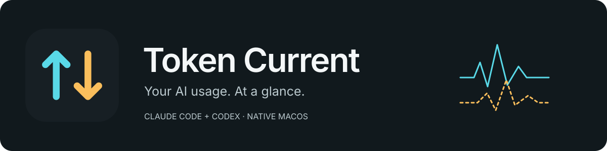

<p align="center">
  
</p>

<p align="center">
  <a href="https://github.com/MrMohebi/token-current/releases/latest"></a>
  <a href="https://github.com/MrMohebi/token-current/actions/workflows/ci.yml"></a>
  
  
</p>

# Token Current

**See how many tokens Claude Code and Codex are using, right in your Mac's menu bar.**

Think of an internet speed meter, but for AI token consumption. Glance at the rate, click for a graph, and see where today's tokens went. Token Current reads the local logs your coding tools already create — no API keys, agent plugins, or account setup.

**[Download for Mac](https://github.com/MrMohebi/token-current/releases/latest/download/TokenCurrent-macos-universal.zip)** · [Install](#install) · [Read the meter](#read-the-meter) · [Troubleshooting](#troubleshooting)

## Install

You need **macOS 14 Sonoma or later**, on an Apple silicon or Intel Mac. One universal download works for both.

### Option 1: download and open

1. **[Download Token Current](https://github.com/MrMohebi/token-current/releases/latest/download/TokenCurrent-macos-universal.zip)** and double-click the ZIP to unzip it.
2. Drag **TokenCurrent.app** into your **Applications** folder.
3. Open the app. Look for the **up/down arrows in the menu bar**, near the clock. There is no Dock icon.

**First-launch note:** this initial release is ad-hoc signed and **not Apple-notarized**. If macOS blocks it, try opening it once, then go to **System Settings → Privacy & Security → Open Anyway** for Token Current. You do not need to disable Gatekeeper.

### Option 2: one terminal command

```bash
curl -fsSL https://raw.githubusercontent.com/MrMohebi/token-current/main/Scripts/install.sh | bash
```

The installer downloads the latest release, verifies its checksum and app signature, installs it in **`~/Applications`** without `sudo`, and opens it. Running the command again updates that copy. It does not change your AI tools or erase usage history. You can [read the installer](Scripts/install.sh) before running it.

**No Node.js, ccusage, Homebrew, or paid API account is needed to run Token Current.**

## Get your first reading

1. Use Claude Code or Codex on this Mac as you normally would.
2. Click Token Current's menu bar arrows. Existing logs load automatically, including today's earlier usage.
3. Send a prompt. The meter changes when the coding tool writes a usage update.

If nothing appears, open **Settings → Local sources** and check the status beside each tool. Token Current monitors locally available CLI/session logs; it does not read browser conversations or sessions on another machine.

## What you get

| Feature | What it helps you see |
| --- | --- |
| Menu bar rate | Reported token consumption without switching windows |
| 60-second graph | Bursts, pauses, and recent activity |
| All / Claude / Codex | One combined view or a single tool |
| Today's totals | Input, output, and cached tokens |
| Local monitoring | Usage metadata stays on your Mac |
| Display options | Full rate, compact rate, or icon only |
| Launch at login | Keep the meter available when you start your Mac |

The popover follows your Mac's light/dark appearance. Claude has a **cyan solid trace**; Codex has an **amber dashed trace**, with provider names alongside the numbers. Reduce Motion and Reduce Transparency are respected.

## Read the meter

An example menu bar reading is **`↕ 2.4k tok/s`**. Here, `k` means thousand, so that is about 2,400 reported tokens per second.

| Reading | Meaning |
| --- | --- |
| **tok/s** | Newly reported input + output tokens, averaged over the last **10 seconds** |
| **Input** | Tokens supplied to the model, including cached input |
| **Output** | Tokens returned by the model, including reasoning when the source includes it |
| **Cached** | Cache reads and writes reported by the tool; already included in Input |
| **0** | A connected source has no newly reported tokens in the last 10 seconds |
| **—** | There is no current measurement, or monitoring is paused/loading |

**The display refreshes every second, but source logs may update in batches.** This measures reported consumption, not exact model generation speed. A large prompt or cached-context update can create a burst. Zero while a tool is working can simply mean it has not written its next usage record yet.

Historical imports, restart, resume, and sleep/wake catch-up do not create false live spikes. Today follows your Mac's local calendar and time zone. The meter does not show dollars, subscription quota percentages, or remaining plan allowance.

## Make it yours

Click the menu bar icon, then **Settings**:

- **Menu bar display:** choose a rate with units, a compact rate, or just the icon.
- **Launch at login:** start the app automatically. macOS may ask you to approve it in Login Items.
- **Local sources:** point the app at a custom Claude or Codex data folder, then click **Apply folders**.
- **Clear local usage history:** reset stored totals and the graph. Previously read usage stays cleared; new usage continues to count.

**Pause / Resume** is in the popover footer. Pausing stops new reads; resuming catches up today's totals without a fake speed burst. **Quit** is in the **More (⋯)** menu.

With the popover open, **⌘,** opens Settings, **⇧⌘P** pauses/resumes, and **⌘Q** quits.

### Where the data comes from

| Tool | Default data folder | What the app reads inside it |
| --- | --- | --- |
| Claude Code | `~/.claude` | `projects/**/*.jsonl`, including nested agents |
| Codex | `~/.codex` | `sessions/**/*.jsonl` and `archived_sessions/**/*.jsonl` |

First launch also checks `CLAUDE_CONFIG_DIR`, `CODEX_HOME`, and Claude's XDG config location (`$XDG_CONFIG_HOME/claude` or `~/.config/claude`). Saved folder selections take precedence. Finder-launched apps may not inherit variables set in your terminal, so use Settings if a custom location is missed.

In Settings, choose the **data home** containing `projects` for Claude, or `sessions` / `archived_sessions` for Codex, rather than an individual log file. One data home per provider is monitored in this version.

## Troubleshooting

| What you see | What to do |
| --- | --- |
| macOS blocks first launch | Use the **Open Anyway** steps in [Install](#install). The initial release is not notarized. |
| No Dock icon | Expected: the app lives in the menu bar. Look near the clock. If crowded, free some menu bar space. |
| Waiting for usage | Start a local Claude Code or Codex session and wait for a usage update. Check source folders in Settings. |
| Not found | Select the correct data home in Settings and click **Apply folders**. |
| Folder access denied | Choose a folder your macOS account can read and check its permissions in Finder. |
| Unsupported log format | Check for a newer Token Current release. [Report the tool version and status](https://github.com/MrMohebi/token-current/issues/new); do not post private transcripts. |
| Zero while the AI works | The source may not have flushed a usage record yet. The meter also returns to zero after 10 seconds without new usage. |
| A new session appears late | Discovery has a 30-second fallback. Very large log trees may use that interval. |
| Installer says checksum/signature failed | Your installed app is left unchanged. Retry the download or use the manual ZIP; report repeated failures. |

Compressed `.jsonl.zst` archives are not supported in v1. Older fork logs can undercount their first request when inherited usage cannot be separated. Local token counts are not a substitute for the provider's billing or quota dashboard.

## Update or uninstall

**Update:** quit the app, download the latest ZIP, and replace the existing app in the same Applications folder. If you used the terminal installer, run that command again. Settings and local usage records stay in place.

**Uninstall:** turn off Launch at login, quit from the More menu, then move TokenCurrent.app to the Trash. Optional local usage data is in `~/Library/Application Support/Token Current`; preferences use bundle ID `app.tokencurrent.mac`.

The app retains only usage metadata, deduplication counters, and file checkpoints. It does not store prompts, responses, or credentials, and it does not send telemetry. Clear history preserves checkpoints so old logs are not immediately counted again.

## Icons and logos

**[Download the brand kit](https://github.com/MrMohebi/token-current/releases/latest/download/TokenCurrent-brand-kit.zip)** for SVG logos, a 1024px PNG app icon, and the native macOS `.icns` file.

| Asset | Use |
| --- | --- |
| [App icon](assets/brand/icon.svg) | Full-color square icon |
| [Light-background logo](assets/brand/wordmark-light.svg) | Dark lettering on light backgrounds |
| [Dark-background logo](assets/brand/wordmark-dark.svg) | Light lettering on dark backgrounds |
| [Monochrome mark](assets/brand/mark-monochrome.svg) | A single-color arrow symbol |
| [Project banner](assets/brand/banner.svg) | Repository and project header |

The app bundle and vector assets use the same cyan/amber arrow geometry. [Brand notes](assets/brand/README.md) describe spacing and use.

## Build from source

Requires **Swift 6 / Xcode 16 or later** on macOS. The app has no third-party runtime dependencies.

```bash
git clone https://github.com/MrMohebi/token-current.git
cd token-current
swift test
Scripts/compile_and_run.sh
```

Build a universal app without opening it:

```bash
ARCHES="arm64 x86_64" SIGNING_MODE=adhoc Scripts/package_app.sh release
```

The result is **`build/TokenCurrent.app`**. Packaging draws the icon natively and assembles a standard macOS app bundle.

<details>
<summary><strong>Architecture, verification, and release details</strong></summary>

### Architecture

- `Sources/TokenCurrentCore`: narrow log decoders → normalized usage → SQLite ledger → rolling-rate calculator.
- `Sources/TokenCurrent`: SwiftUI menu bar, popover, chart, settings, directory notifications, and login-item integration.
- `Tests/TokenCurrentCoreTests`: provider accounting and filesystem integration scenarios.
- `Tests/Installer`: installation and failure-recovery tests with simulated system commands.
- `Scripts`: local launch, bundle/icon generation, installer, signing, and notarization.

Parsing runs outside the UI. Reads are bounded, incomplete lines wait for a newline, and unchanged checkpoints do not cause database writes. Directory notifications are backed by a 30-second discovery scan. The watcher cap is 256 directories. Only files modified today are initially scanned; complete cumulative baselines within those files are processed for correct deltas. SQLite events from earlier days are pruned; deduplication metadata persists.

Claude input combines uncached, cache-read, and cache-creation fields. Codex cached/reasoning tokens are subsets of input/output and are not counted twice. Revised Claude messages and cumulative Codex snapshots are deduplicated. Modern `token_usage_record` and legacy `event_msg/token_count` records share one ledger. Decreasing/stale cumulative snapshots never subtract usage or create a duplicate charge.

References: [Claude cache accounting](https://platform.claude.com/docs/en/build-with-claude/prompt-caching), [Codex protocol](https://github.com/openai/codex/blob/main/codex-rs/protocol/src/protocol.rs), [Codex rollout serialization](https://github.com/openai/codex/blob/main/codex-rs/history/src/rollout_payload.rs), and [ccusage](https://github.com/ccusage/ccusage) for independent local-log discovery and deduplication patterns. ccusage is not an app dependency.

### Verify

```bash
swift test
python3 -m unittest discover -s Tests/Installer -v
bash -n Scripts/*.sh
```

The [macOS workflow](https://github.com/MrMohebi/token-current/actions) builds and checks the universal app, runs tests, verifies its signature, smoke-tests native launch, and prepares download archives. The 28 Swift scenarios passed on macOS. The six installer scenarios cover installation, updates, unsupported systems, invalid identity/signature/checksum, and failed copying.

The core also tests on Linux with Swift 6 and `libsqlite3-dev`; this does not validate the native interface. Interactive visual, keyboard/VoiceOver, login-item, and Instruments review remain pending. See [verification evidence](docs/VERIFICATION.md) and the [Mac validation checklist](docs/MAC_VALIDATION.md).

### Developer ID releases

The public initial release uses ad-hoc signing. To create an Apple-notarized build, configure a Developer ID Application identity and a `notarytool` Keychain profile, then run:

```bash
APP_IDENTITY="Developer ID Application: Your Name (TEAMID)" \
NOTARY_PROFILE="TokenCurrent" \
Scripts/sign-and-notarize.sh
```

This builds with hardened runtime, notarizes and staples the app, and verifies Gatekeeper acceptance. It does not publish a GitHub release. Increment `version.env` before each release. Direct distribution is used without App Sandbox so the app can read the selected log folders.

The product and interface decisions are recorded in [PRODUCT.md](PRODUCT.md) and [DESIGN.md](DESIGN.md). Adapted packaging templates are credited in [third-party notices](THIRD_PARTY_NOTICES.md).

</details>

## Feedback

[Report a bug or suggest an improvement](https://github.com/MrMohebi/token-current/issues/new). Include your macOS version, coding tool/version, and the status shown in Settings. Keep prompts, responses, and credentials out of reports.
